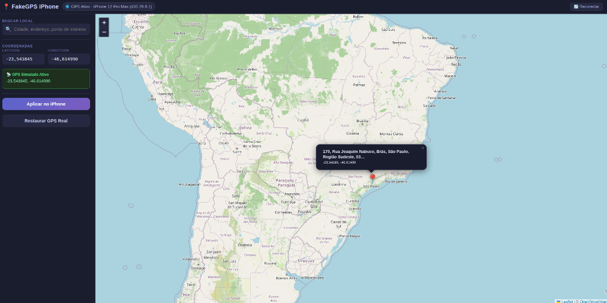

# FakeGPS iPhone 📍

> Modern, lightweight virtual location spoofer for connected iPhones. Cross-platform web interface for **Linux**, **Windows**, and **macOS**.

[](https://github.com/maxxcleiton/fakegps-iphone-web)
[](https://github.com/maxxcleiton/fakegps-iphone-web)
[](https://opensource.org/licenses/MIT)

**Languages:** [🇺🇸 English](README.md) | [🇧🇷 Português](README.pt-BR.md)

<p align="center">
  
</p>

---

## 🌟 Key Features

* **Universal iOS Support:** Works on iOS 12 through **iOS 17, 18, and iOS 26+**.
* **Cross-Platform:** Runs seamlessly on **Linux (Ubuntu, Xubuntu, Debian, Mint)**, **Windows**, and **macOS**.
* **No Root / Sudo Required for Spoofing:** Communicates with iOS via in-process userspace RemoteXPC tunnel (`pymobiledevice3`).
* **Interactive Map GUI:** Clean dark-themed web interface powered by Leaflet and OpenStreetMap. Single-world bounds prevent disorienting map loops.
* **City & Address Search:** Search any street, landmark, or city worldwide via Nominatim.
* **Persistent Session:** Coordinates remain fixed on the iPhone until you click "Restore Real GPS".
* **One-Click Server Shutdown:** Includes a dedicated **"⏹ Desligar"** (Stop) button in the header to cleanly terminate the server from the browser.
* **Standalone Windows `.exe`:** No Python installation needed on Windows—just download and double-click!

---

## 🚀 Quick Start by Operating System

### 🪟 Windows (10 / 11)

1. **Prerequisite:** Ensure you have **Apple Devices** (from Microsoft Store) or **iTunes** installed so Windows has the official Apple USB drivers.
2. **Download:** Get the standalone **`FakeGPS-iPhone.exe`** from the [Releases](https://github.com/maxxcleiton/fakegps-iphone-web/releases) page.
3. **Run:** Double-click **`FakeGPS-iPhone.exe`**.
   * It starts the local service and opens your browser at `http://localhost:8765` automatically!
   *(Alternative: Download `FakeGPS-iPhone-Windows.zip` and run `start.bat` if you prefer).*

---

### 🐧 Linux (Ubuntu, Xubuntu, Debian, Mint)

#### Option A: Install `.deb` Package (Recommended)
1. Download the **`fakegps-iphone_*_all.deb`** package from the [Releases](https://github.com/maxxcleiton/fakegps-iphone-web/releases) page.
2. Install via terminal:
   ```bash
   sudo apt install ./fakegps-iphone_*_all.deb
   ```
3. Open **FakeGPS iPhone** from your application menu or run `fakegps-iphone` in terminal.

#### Option B: Run from Source
```bash
git clone https://github.com/maxxcleiton/fakegps-iphone-web.git
cd fakegps-iphone-web
./start.sh
```

---

### 🍎 macOS

1. Download **`FakeGPS-iPhone-macOS.zip`** from [Releases](https://github.com/maxxcleiton/fakegps-iphone-web/releases) (or clone the repository).
2. Extract the ZIP and run in Terminal:
   ```bash
   ./start-mac.sh
   ```
   *(macOS has native Apple USB communication services built-in; no extra drivers required!)*

---

## 📱 iPhone Setup

1. **USB Trust:** Connect your iPhone via USB, unlock the screen, tap **"Trust This Computer"**, and enter your passcode.
2. **Developer Mode (iOS 16+):**
   * Go to **Settings** → **Privacy & Security** → **Developer Mode**.
   * Toggle it **On** and follow the prompt to reboot your device.

---

## 🛠️ Building Packages Locally

To rebuild the Debian package locally on Linux:
```bash
./build-deb.sh
```

---

## 🤝 Contributing

Contributions, issues, and feature requests are welcome! Feel free to check the [issues page](https://github.com/maxxcleiton/fakegps-iphone-web/issues).

---

## 📄 License

Open source under the [MIT License](LICENSE).
