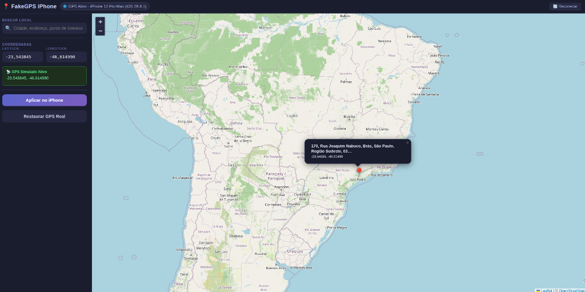

# FakeGPS iPhone 📍

> Simulador moderno e leve de localização virtual (Fake GPS) para iPhones conectados via USB. Interface web multiplataforma para **Linux**, **Windows** e **macOS**.

[](https://github.com/maxxcleiton/fakegps-iphone-web)
[](https://github.com/maxxcleiton/fakegps-iphone-web)
[](https://opensource.org/licenses/MIT)

**Idiomas:** [🇺🇸 English](README.md) | [🇧🇷 Português](README.pt-BR.md)

<p align="center">
  
</p>

---

## 🌟 Recursos Principais

* **Compatibilidade Universal:** Funciona desde o iOS 12 até o **iOS 17, 18 e iOS 26+**.
* **Multiplataforma Real:** Roda de forma idêntica no **Linux (Ubuntu, Xubuntu, Debian, Mint)**, **Windows** e **macOS**.
* **Sem Necessidade de Root / Sudo:** Comunica-se com o iOS diretamente via túnel RemoteXPC userspace (`pymobiledevice3`).
* **Interface Gráfica com Mapa:** Interface web limpa em tema escuro (Leaflet + OpenStreetMap). Limites geográficos travados para evitar repetições confusas da Terra.
* **Busca por Cidades e Endereços:** Pesquise qualquer rua, ponto turístico ou cidade do mundo via Nominatim.
* **Sessão Persistente:** Fixa a coordenada simulada no aparelho para que o iOS não restaure o GPS real sozinho.
* **Botão Desligar:** Botão **"⏹ Desligar"** no cabeçalho para finalizar o servidor em segundo plano diretamente pelo navegador.
* **Executável `.exe` para Windows:** Não precisa de Python instalado no Windows—basta baixar e dar dois cliques!
* **Suporte ao Simulador do Xcode (macOS):** Além de iPhones físicos na USB, detecta e altera a localização do **iOS Simulator** do Xcode na hora, eliminando a chatice de digitar coordenadas em arquivos GPX ou na janela Custom Location da Apple.

---

## 🚀 Como Usar por Sistema Operacional

### 🪟 Windows (10 / 11)

1. **Pré-requisito:** Certifique-se de ter o app **Dispositivos Apple (Apple Devices)** (da Microsoft Store) ou o **iTunes** instalado para que o Windows possua os drivers USB oficiais da Apple.
2. **Download:** Baixe o executável **`FakeGPS-iPhone.exe`** na aba [Releases](https://github.com/maxxcleiton/fakegps-iphone-web/releases).
3. **Execução:** Dê dois cliques em **`FakeGPS-iPhone.exe`**.
   * Ele inicia o serviço e abre o navegador em `http://localhost:8765` automaticamente!
   *(Alternativa: Baixe `FakeGPS-iPhone-Windows.zip` e execute `start.bat` se preferir).*

---

### 🐧 Linux

#### Opção A: Debian, Ubuntu, Xubuntu, Linux Mint (.deb)
1. Baixe o pacote **`fakegps-iphone_*_all.deb`** na aba [Releases](https://github.com/maxxcleiton/fakegps-iphone-web/releases).
2. Instale no terminal:
   ```bash
   sudo apt install ./fakegps-iphone_*_all.deb
   ```
3. Abra pelo menu de aplicativos (**FakeGPS iPhone**) ou digite `fakegps-iphone` no terminal.

#### Opção B: Rocky Linux, Fedora, RHEL, Arch ou direto do código
1. Instale os pré-requisitos:
   * **Rocky Linux / RHEL / Fedora:**
     ```bash
     sudo dnf install -y epel-release && sudo crb enable
     sudo dnf install -y python3 python3-pip git usbmuxd libimobiledevice
     sudo systemctl enable --now usbmuxd
     ```
   * **Arch Linux / Manjaro:**
     ```bash
     sudo pacman -S python python-pip git usbmuxd libimobiledevice
     sudo systemctl enable --now usbmuxd
     ```
2. Clone e inicie:
   ```bash
   git clone https://github.com/maxxcleiton/fakegps-iphone-web.git
   cd fakegps-iphone-web
   ./start.sh
   ```

---

### 🍎 macOS (iPhone Físico ou Simulador do Xcode)

No Mac, o FakeGPS funciona tanto com **iPhone físico via cabo USB** quanto com o **Simulador do Xcode** aberto na tela!

#### Como Iniciar no Mac:
1. Baixe o arquivo **`FakeGPS-iPhone-macOS.zip`** na aba [Releases](https://github.com/maxxcleiton/fakegps-iphone-web/releases) (ou clone o repositório).
2. Extraia o ZIP. Você tem **3 formas práticas de abrir**:
   * **Opção 1 (Aplicativo Nativo com Ícone):** Dê dois cliques em **`FakeGPS iPhone.app`** *(você pode arrastar para a pasta **Aplicativos** ou fixar no Dock do Mac!)*
   * **Opção 2 (Dois cliques no Finder):** Dê dois cliques no arquivo **`FakeGPS.command`** *(executa direto sem precisar abrir terminal)*
   * **Opção 3 (Terminal):** Execute `./start-mac.sh`
3. O navegador abrirá automaticamente em `http://localhost:8765`.

#### 📱 Usando com o Simulador do Xcode (iOS Simulator):
- **O problema nativo do Xcode:** Por padrão, para mudar a localização no Simulador da Apple você precisa ir em `Features > Location > Custom Location` e digitar números de latitude e longitude manualmente toda hora, sem mapa e sem busca de endereços.
- **Com o FakeGPS:** Deixe o Simulador do Xcode aberto (`booted`). O FakeGPS detecta o simulador automaticamente! Basta pesquisar um endereço ou clicar em qualquer ponto do mapa para o Simulador atualizar a posição instantaneamente.

#### 🔌 Usando com iPhone Físico na USB:
- Basta plugar o iPhone no cabo USB, tocar em "Confiar neste Computador" e usar normalmente *(o macOS já possui os drivers de comunicação USB da Apple integrados nativamente no sistema)*.

---

## 📱 Configuração no iPhone

1. **Confirmação USB:** Ao plugar o iPhone na USB, desbloqueie a tela, toque em **"Confiar neste Computador"** e digite seu código de tela.
2. **Modo Desenvolvedor (iOS 16+):**
   * Vá em **Ajustes** → **Privacidade e Segurança** → **Modo Desenvolvedor**.
   * Ative a opção e siga as instruções na tela para reiniciar o aparelho.

---

## 🛠️ Como Recriar o Pacote `.deb` no Linux

Se você alterar arquivos do código, recrie o `.deb` com:
```bash
./build-deb.sh
```

---

## 📄 Licença

Código aberto sob a licença [MIT](LICENSE).
